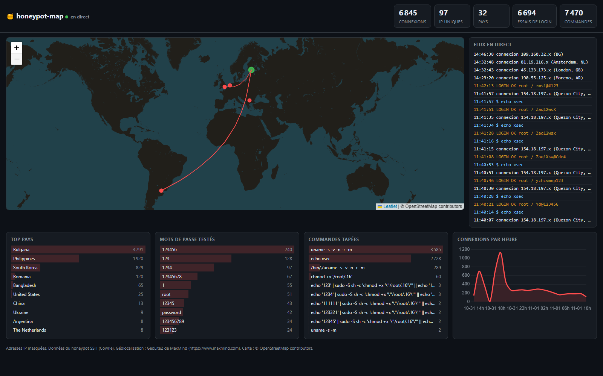

# honeypot-map

> Un honeypot SSH (Cowrie) qui attire les bots d'Internet, un pipeline Python qui analyse chaque attaque, et un dashboard temps réel avec carte animée.




## Pourquoi ce projet ?

Un serveur SSH exposé sur Internet est attaqué en quelques minutes. **honeypot-map** transforme ce bruit en données : d'où viennent les attaques, quels mots de passe sont essayés, que font les bots une fois « entrés » ? Le projet couvre toute la chaîne : déploiement d'un leurre, collecte, normalisation, enrichissement, API temps réel, visualisation, rapport d'analyse et durcissement du serveur.

## Fonctionnalités

- **Honeypot** [Cowrie](https://github.com/cowrie/cowrie) : faux shell SSH qui enregistre identifiants, commandes et fichiers téléchargés
- **Ingestion** des logs JSON vers SQLite, en continu, sans doublons
- **Enrichissement GeoIP** : pays, ville, coordonnées et réseau (ASN) de chaque adresse
- **API FastAPI** : statistiques REST et flux **WebSocket** des attaques en direct
- **Dashboard** : carte Leaflet avec arcs animés, compteurs, classements, courbe horaire et flux en direct
- **Rapport d'analyse** automatique en Markdown (pays, identifiants, commandes, objectifs des bots, chronologie)
- **Déploiement reproductible** : Docker Compose, script de durcissement du serveur, guide pas à pas
- **Tests automatisés** et intégration continue (GitHub Actions)

## Architecture

```
 Bots d'Internet ──► port 22 ──► Cowrie (Docker) ──► cowrie.json
                                                        │
                                                        ▼
                                        ingester  (ingest.py --follow)
                                                        │
                                                        ▼
                         SQLite ◄── enrich (geoip_enrich.py, toutes les 60 s)
                            │
                            ▼
                FastAPI (lecture seule) ── REST + WebSocket ──► Dashboard (Leaflet, Chart.js)
                            │
                            └──► analysis/report.py ──► reports/*.md
```

| Brique | Technologie |
|---|---|
| Honeypot | Cowrie |
| Ingestion et enrichissement | Python (bibliothèque standard + `geoip2`) |
| Stockage | SQLite |
| API | FastAPI, uvicorn, WebSocket |
| Front | HTML/JS, Leaflet, Chart.js |
| Déploiement | Docker Compose, Caddy (HTTPS, optionnel) |
| Qualité | pytest, GitHub Actions |

## Démarrage rapide (sans honeypot, avec des données d'exemple)

Le dépôt fournit `samples/cowrie.sample.json`, un fichier de logs **synthétique** au format Cowrie (généré par `tools/generate_sample_logs.py`). Ce ne sont pas de vraies attaques.

```bash
git clone https://github.com/zabubu/honeypot-map.git
cd honeypot-map
python -m venv .venv && source .venv/bin/activate      # Windows : .venv\Scripts\activate
pip install -r requirements.txt

python ingester/ingest.py samples/cowrie.sample.json   # crée data/honeypot.db
```

La géolocalisation demande les bases gratuites **GeoLite2 City et ASN** de MaxMind (compte gratuit), à placer dans `data/` :

```bash
python ingester/geoip_enrich.py
```

Lancer l'API et le dashboard en mode démo, qui rejoue les événements en boucle :

```bash
REPLAY=1 python -m uvicorn api.main:app        # PowerShell : $env:REPLAY="1"; python -m uvicorn api.main:app
```

Puis ouvrir http://127.0.0.1:8000 (documentation de l'API : `/docs`).

## Déploiement réel

Le guide [docs/DEPLOY.md](docs/DEPLOY.md) décrit le déploiement complet sur un VPS : sécurisation du serveur (`deploy/harden.sh`), installation de Docker, lancement de `docker-compose.prod.yml`, accès au dashboard par tunnel SSH ou en HTTPS avec authentification.

## Rapport d'analyse

```bash
python analysis/report.py --db data/prod.db --exclude-ip <ton_ip>
```

Le rapport est écrit dans `reports/`. Les adresses IP y sont masquées, les URL défanguées, et tout texte venant d'un attaquant est neutralisé avant d'être écrit.

## API

| Route | Description |
|---|---|
| `GET /api/summary` | Compteurs globaux |
| `GET /api/countries` | Top pays |
| `GET /api/passwords`, `/api/usernames`, `/api/commands`, `/api/ips` | Classements (`?limit=`) |
| `GET /api/timeline` | Connexions par heure (`?days=`) |
| `GET /api/attacks/recent` | Derniers événements géolocalisés |
| `WS /ws/attacks` | Flux temps réel des attaques |

## Choix de sécurité et de vie privée

- Serveur **dédié et jetable**, sans donnée personnelle ; SSH d'administration sur un autre port, par clé uniquement, avec pare-feu et fail2ban.
- **API en lecture seule** sur la base, exposée uniquement en local ; accès public via un proxy HTTPS authentifié.
- **Adresses IP masquées** dans l'API, le dashboard et les rapports.
- Les données des attaquants (commandes, mots de passe, URL) sont **toujours traitées comme non fiables** : affichage en texte brut côté dashboard (pas d'`innerHTML`), blocs de code et URL défanguées dans les rapports.
- Les conteneurs d'ingestion et d'enrichissement n'ont **aucun accès réseau**.
- Les fichiers téléchargés par les bots ne sont **jamais exécutés ni publiés** : seules leurs empreintes sont conservées.

## Résultats

Premiers résultats, sur environ **21 heures** de collecte (31 octobre 14h29 → 1er novembre 11h42 UTC). Rapport complet : [reports/report-2026-11-01.md](reports/report-2026-11-01.md).

| Indicateur | Valeur |
|---|---|
| Connexions SSH | 6 845 (≈ 7 700 par jour) |
| Adresses IP uniques | 97 |
| Pays d'origine (top 3) | Bulgarie (55 %), Philippines (28 %), Corée du Sud (12 %) |
| Mots de passe distincts essayés | 2 760 |
| Commandes enregistrées | 7 470 |
| Fichiers téléchargés | 0 |

**Ce qu'on observe :**

- **Peu de sources, beaucoup de bruit.** Trois pays et une poignée d'hébergeurs (Banatsync, EWS DS Networks, DAOU Technology) génèrent plus de 95 % des connexions : quelques machines automatisées très actives, pas une foule d'attaquants.
- **Des identifiants sans surprise.** `root` (3 161 essais) et `ubuntu` (956) dominent ; les mots de passe les plus testés sont `123456`, `123`, `1234`, `12345678`, puis `root` et `password`.
- **Des bots, pas des humains.** 97 % des sessions annoncent le client `SSH-2.0-Go` (bibliothèque SSH du langage Go). Une fois « connectés », ils se contentent presque tous d'une commande de reconnaissance (`uname -s -v -n -r -m`, 54 % des sessions) ou d'un simple test (`echo xsec`) pour vérifier qu'ils ont bien un shell.
- **Quelques tentatives d'installation.** Environ 5 % des sessions tentent de rendre exécutable un fichier (`chmod +x /root/.16`), parfois via `sudo` avec le mot de passe deviné, mais aucun téléchargement n'a abouti pendant cette période.

Ces chiffres portent sur moins d'une journée et sur un seul serveur : ils donnent un aperçu, pas une tendance. Le rapport sera mis à jour après une collecte plus longue.

## Limites

- Un seul honeypot et un seul type de service (SSH) : les résultats ne représentent pas Internet dans son ensemble.
- La géolocalisation d'une IP est approximative et reflète souvent un hébergeur plutôt que l'attaquant.
- La classification des commandes repose sur des mots-clés.
- SQLite convient à ce volume ; un trafic beaucoup plus important demanderait une autre base.

## Pistes d'amélioration

- [ ] Tests de l'API HTTP et du WebSocket
- [ ] Honeypots supplémentaires (HTTP, Telnet) et corrélation entre services
- [ ] Enrichissement par des flux de réputation d'IP
- [ ] Alertes (webhook) sur des comportements particuliers
- [ ] Analyse des fichiers récupérés (hashes, règles YARA) dans un environnement isolé

## Crédits

- [Cowrie](https://github.com/cowrie/cowrie), le honeypot
- This product includes GeoLite2 data created by MaxMind, available from https://www.maxmind.com
- Carte : © contributeurs d'[OpenStreetMap](https://www.openstreetmap.org/copyright), [Leaflet](https://leafletjs.com), [Chart.js](https://www.chartjs.org)

## Licence

MIT, voir le fichier `LICENSE`.

## Auteur

**Sabri** — [GitHub](https://github.com/zabubu)
